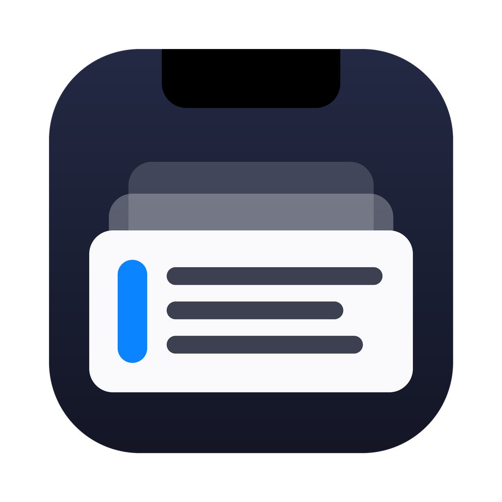

<p align="center"></p>

<h1 align="center">NotchClip</h1>
<p align="center"><b>Your clipboard history, living in the MacBook notch.</b><br>
Move the pointer to the notch (or press <kbd>⌥⌘V</kbd>) and everything you copied is right there — text, links, images and files.</p>

<p align="center">
<a href="https://github.com/Atamutlu33/NotchClip/actions/workflows/ci.yml"></a>


</p>

---

## Why NotchClip

The notch is the one part of the screen you never use. NotchClip turns it into a shelf that drops down when you need it and disappears when you don't:

- **Zero setup.** Text, links, images and Finder files are recorded from the first copy. Password managers and content marked secret are skipped automatically.
- **Hover to open.** Touch the notch with the pointer and the shelf slides out; move away and it tucks back in. Works in full-screen apps and on every Space. Macs without a notch get an invisible hot zone at the top-centre of the screen.
- **Paste where you were.** Click a clip (or press <kbd>↩</kbd>) and it is pasted straight into the app you were typing in. The shelf never steals focus from that app.
- **Find anything.** Type to search across text, link titles, file names, the source app and even **text inside images** (on-device OCR). Matching ignores case and accents, and forgives typos.
- **A drop zone too.** Drag files, images or text onto the notch to keep them on the shelf, then drag them back out into any app.
- **Fast and light.** Native Swift/AppKit/SwiftUI, one small JSON index plus de-duplicated image files, thumbnails decoded once and cached.

## Install

1. Download `NotchClip.zip` from the [latest release](https://github.com/Atamutlu33/NotchClip/releases/latest) (or from the newest [CI run](https://github.com/Atamutlu33/NotchClip/actions)).
2. Unzip and move **NotchClip.app** to **Applications**.
3. The build is ad-hoc signed (not notarized), so the first time **right-click → Open**, or run
   `xattr -dr com.apple.quarantine /Applications/NotchClip.app`.
4. To paste automatically, allow NotchClip in **System Settings → Privacy & Security → Accessibility** (the app asks the first time you paste). Without it, clips are copied and you press <kbd>⌘V</kbd> yourself.

Build from source (Xcode 15+ command line tools):

```bash
git clone https://github.com/Atamutlu33/NotchClip.git
cd NotchClip
scripts/install.sh          # builds, installs to /Applications and launches
```

## Using the shelf

| Key | Action |
| --- | --- |
| <kbd>⌥⌘V</kbd> | Open / close the shelf (changeable in Settings) |
| type | Search |
| <kbd>←</kbd> <kbd>→</kbd> · <kbd>⌘←</kbd> <kbd>⌘→</kbd> | Move selection · first / last |
| <kbd>↩</kbd> or click | Paste into the previous app |
| <kbd>⇧↩</kbd> · <kbd>⌘C</kbd> | Copy only, keep the shelf open |
| <kbd>⌘1</kbd> … <kbd>⌘9</kbd> | Paste the n-th clip |
| <kbd>Space</kbd> · <kbd>↓</kbd> / <kbd>↑</kbd> · <kbd>⌘Y</kbd> | Large preview (full text, image + recognised text, file list) |
| <kbd>⇥</kbd> · <kbd>⇧⇥</kbd> | Switch tab: All, Text, Links, Images, Files, Pinned |
| <kbd>⌘P</kbd> | Pin — pinned clips are kept forever |
| <kbd>⌘⌫</kbd> | Delete clip |
| <kbd>⌘O</kbd> | Open link in browser / show file in Finder |
| <kbd>⌘,</kbd> | Settings |
| <kbd>Esc</kbd> | Close preview → clear search → close shelf |

Right-click a card for the same actions; drag a card out to drop its content anywhere.

## Settings

- **Opening:** hover to open, global shortcut (⌥⌘V, ⌃⌥V, ⇧⌘V, ⌃⌘V or off), menu bar icon, launch at login.
- **Choosing a clip:** paste automatically or copy only.
- **Capture:** images, Finder files, screenshots saved to disk (detected through Spotlight, any language and save location), OCR, link titles, extra apps to ignore.
- **History:** keep unpinned clips for 1 day … forever, at most 100 … 3000 clips; clear history; show the data folder.
- **Pause capture** from the shelf or the menu bar icon at any time.

## Privacy

- Everything is stored locally in `~/Library/Application Support/NotchClip`. There is no account, no analytics, no sync.
- Content flagged with the [nspasteboard.org](http://nspasteboard.org) concealed/transient markers is never recorded, and copies made in 1Password, Bitwarden, Keychain Access, Passwords, KeePassXC, LastPass, Dashlane, Enpass and NordPass are ignored. Add your own apps in Settings.
- Text recognition runs on-device with Apple Vision.
- Link titles are the only network access, can be turned off, and are never fetched for local/private addresses, URLs with credentials, or URLs containing tokens or secrets.

## Architecture

```
Sources/
  NotchClipCore/   Pure Swift (Foundation only): ClipItem, ClipStore (ordering, de-dup,
                   retention, JSON persistence), ClipSearch (ranked fuzzy search),
                   PrivacyPolicy, LinkPrivacy, formatting
  NotchClipKit/    macOS layer: ClipboardMonitor, PasteboardWriter, Paster (⌘V via CGEvent),
                   ImageStore + ImageCodec, OCRService (Vision), LinkTitleService,
                   ScreenshotWatcher (NSMetadataQuery), HotKeyCenter (Carbon),
                   NotchWindowController (non-activating NSPanel, hover tracking,
                   keyboard), SwiftUI shelf views, Settings, AppController, SelfTest
  NotchClip/       Executable entry point
Tests/             XCTest suites for Core and Kit (pasteboard, images, controller, keyboard, layout)
```

Key design choices:

- **Non-activating panel.** The shelf takes keyboard focus without activating NotchClip, so the app you were using stays frontmost and receives the paste.
- **Content-addressed storage.** Every clip has a content hash; copying something again moves the existing clip to the front instead of creating a duplicate, keeping its pin and recognised text. Image files are named by their hash.
- **Testable seams.** Pasteboard, paste action, permission check and storage location are injectable, so the full pipeline is tested against private pasteboards and temporary folders.

## Testing

```bash
swift test                                               # unit tests
scripts/build-app.sh                                     # universal .app + zip
build/NotchClip.app/Contents/MacOS/NotchClip --self-test # end-to-end test of the packaged app
```

CI runs all three on macOS for every push. The self-test drives the real app — capture, de-duplication, secret filtering, images, OCR, search, opening the notch window, keyboard navigation, preview, paste, pinning, persistence and cleanup — against a private pasteboard, so it never touches your clipboard.

## Credits

Inspired by [ClipBoardLine](https://github.com/orkunisitmak/clipboardline) by Orkun Işıtmak (itself based on Tendedero by Alejandro Buján). NotchClip is an independent implementation written from scratch.

## License

MIT © 2026 Ata Mutlu
